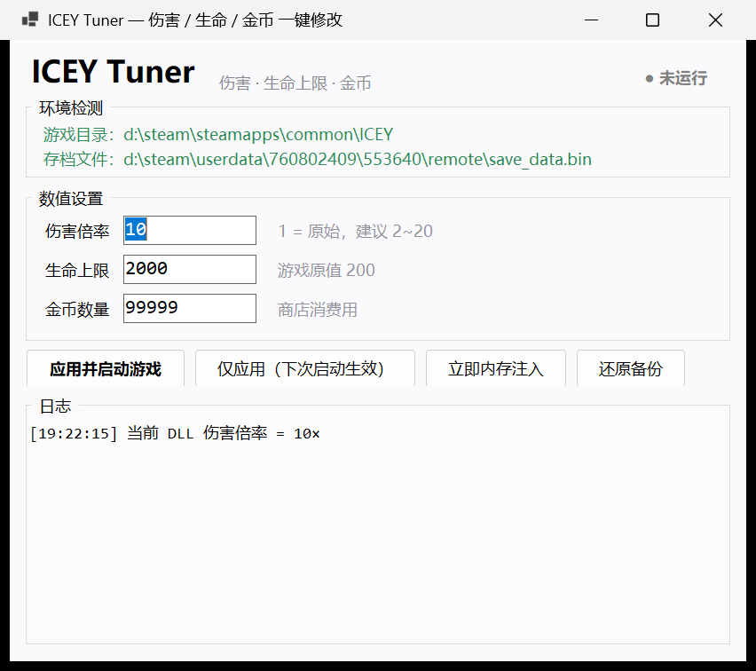

# ICEY Project: Rise to God

《ICEY》的实用工具集合。目前包含一个图形化修改器：**ICEY Tuner**。

> 仅用于单机游戏本地修改与学习交流，请勿用于任何商业用途。

---

## ICEY Tuner

改**伤害倍率**、**生命上限**、**金币数量**，支持启动游戏时自动内存注入。

- C# / .NET 8 / WinForms，无第三方依赖
- 主程序 **148 KB**
- 不修改游戏本体资源，只改 DLL 中的一个浮点常量 + 存档中的两个数字



---

## 下载

| 版本 | 文件 | 说明 |
|---|---|---|
| **未签名版** | [`release/ICEY_Tuner_v1.0.0_unsigned.zip`](release/ICEY_Tuner_v1.0.0_unsigned.zip) | 直接解压运行，**无数字签名** |

解压后双击 `ICEY_Tuner.exe`。

### 运行要求

- Windows 10 / 11 x64
- .NET 8 Desktop Runtime（[下载](https://dotnet.microsoft.com/download/dotnet/8.0)）
  - 已装 .NET 8 SDK 的机器无需额外安装

### 关于 SmartScreen

未签名程序首次运行可能提示「Windows 已保护你的电脑」——这是**未签名 exe 的声誉提示**，不是病毒报告。
点「更多信息」→「仍要运行」即可。

想自己签名，见下方「代码签名」。

---

## 功能

| 输入 | 范围 | 写入位置 |
|---|---|---|
| 伤害倍率 | 0.1 ~ 1000 | `Assembly-CSharp.dll` 中 `PlayerDamageCalculate.PlayerAtk()` 的倍率常量 |
| 生命上限 | 1 ~ 999999 | 存档 `PlayerAttributeGameData.maxHP` + `currentHP` |
| 金币数量 | 0 ~ 99999999 | 存档 `Equipment.CoinNum` |

四个按钮：

| 按钮 | 行为 |
|---|---|
| **应用并启动游戏** | 写 DLL → 写存档 → 启动 `ICEY.exe` → 轮询 120 秒，定位到角色对象后自动注入 |
| **仅应用（下次启动生效）** | 只写文件 |
| **立即内存注入** | 游戏已在运行时直接改进程内存（需角色已加载） |
| **还原备份** | DLL / 存档恢复到首次修改前 |

---

## 原理

### 1. 伤害：特征码定位

`PlayerAtk()` 的方法体头 + 紧随的 `ldc.r4` 操作码，在整个 DLL 中唯一：

```
13 30 07 00 89 00 00 00 2F 00 00 11 22 [4 字节 float]
```

只替换那 4 个字节，长度不变，不触碰元数据。

伤害公式（反编译确认）：

```
最终伤害 = PlayerAtk()                      ← baseAtk(40) × 难度系数 × 连击加成
         × 招式倍率 × 1.5^(攻击等级-1)
         × Random(0.9, 1.1)
         → Clamp(0, 999)
```

### 2. 存档：按字段正则替换

`save_data.bin` = 7-bit 变长长度前缀 + UTF-8 JSON + 补零到 65536。

写入时只正则替换 `"maxHP"` / `"currentHP"` / `"CoinNum"` 三个数字，
**其余字节完全不动**（避免 JSON 重新序列化造成的浮点格式漂移）。
已用测试验证：同值回写后文件字节完全一致。

### 3. 内存注入：值扫描 + 结构校验

Mono 无符号表，靠固定布局特征定位（x64）：

```
PlayerAttribute  +0x10 faceDir(±1)  +0x14 maxHP  +0x18 currentHP
                 +0x24 moveSpeed(0<x<60)  +0x40 baseAtk
Equipment        +0x10 CoinNum  +0x14 HasKey(0/1)
```

先找目标 int → 校验对象头 vtable 落在已加载模块内 → 校验相邻字段合理。
**任一校验不通过就不写**，绝不把随机内存改成垃圾值。

---

## 构建

```powershell
# 需要 .NET 8 SDK
dotnet publish -c Release -r win-x64 --self-contained false
```

产物在 `src/bin/Release/net8.0-windows/win-x64/publish/`。

想做成不依赖运行时的单文件：

```powershell
dotnet publish -c Release -r win-x64 --self-contained true `
  -p:PublishSingleFile=true -p:EnableCompressionInSingleFile=true
```

## 代码签名（可选）

`src/sign.ps1` 提供了基于自签名证书链的签名脚本：

```
根 CA (自签名, CA=true)  →  叶证书 (EKU=Code Signing)  →  签名 exe/dll
```

需要先自行生成证书并装入信任区，脚本会读取 `signing/leaf-thumb.txt` 里的指纹。
自签名只在本机受信任；全球信任需购买 OV/EV 代码签名证书。

---

## 目录结构

```
├── src/
│   ├── ICEYTuner.csproj
│   ├── Program.cs
│   ├── MainForm.cs
│   ├── app.manifest
│   ├── sign.ps1
│   └── Core/
│       ├── Native.cs        # kernel32 P/Invoke
│       ├── Paths.cs         # Steam 库 / 存档路径探测
│       ├── DllPatcher.cs    # 伤害倍率
│       ├── SaveFile.cs      # 存档读写
│       └── MemoryEngine.cs  # 进程附加与扫描
├── docs/screenshot.png
└── release/ICEY_Tuner_v1.0.0_unsigned.zip
```

---

## 免责声明

本项目仅用于学习 Windows 进程内存操作、PE 文件结构与 JSON 序列化等知识。
请自行承担使用风险，修改前务必备份存档与 `Assembly-CSharp.dll`。

游戏《ICEY》版权归上海幻刃网络（FantaBlade）所有，本项目与官方无关。

## License

MIT
